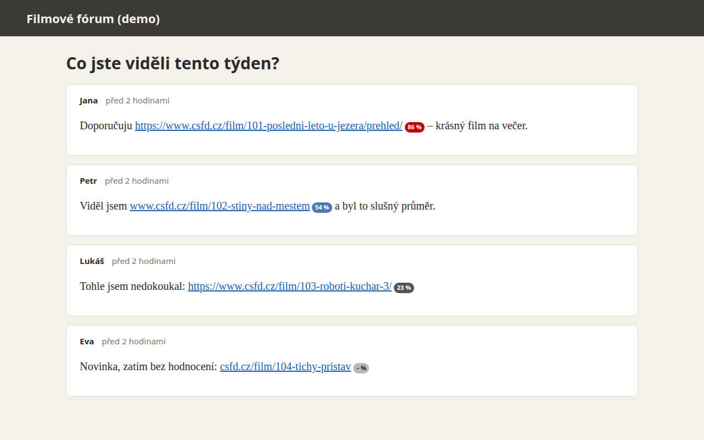
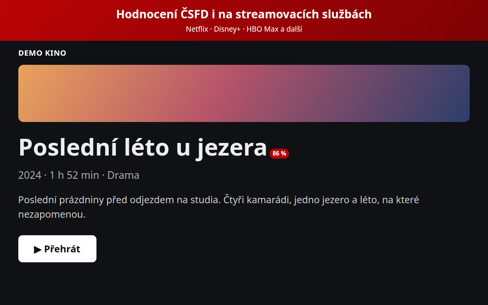

# ČSFD hodnocení všude

**Hodnocení ČSFD uvidíte hned tam, kde se o filmu mluví.** Rozšíření pro Chrome, Edge a Firefox ukáže hodnocení filmu v procentech u odkazů na ČSFD na jakémkoli webu (na fórech, v diskuzích, na blozích i na Facebooku) a u filmů a seriálů na Netflixu, Disney+, HBO Max a dalších streamovacích službách.

## Instalace

- Chrome: *již brzy v Chrome Web Store*
- Edge: *již brzy v Edge Add-ons*
- Firefox: *již brzy na addons.mozilla.org*

## Jak to funguje

- Textové odkazy na ČSFD se změní na klikatelné, a to i u seriálů a epizod.
- Hodnocení se ukáže hned u prvních 10 filmů na stránce. U ostatních se načte, když na odkaz najedete myší.
- Barvy jako na ČSFD: červená od 70 %, modrá 30–69 %, šedá pod 30 %.
- Stačí si vybrat: malý odznak u odkazu, nebo jen plovoucí karta při najetí myší (v Nastavení).
- Na streamovacích službách ukáže hodnocení u otevřeného detailu filmu nebo seriálu: Netflix, Disney+, HBO Max, Apple TV, Prime Video, SkyShowtime, Oneplay, iVysílání ČT, Prima+, Voyo, Canal+, Rakuten TV, MUBI, KVIFF.TV a JustWatch. Když si není jisté, který film to je, ukáže „ČSFD ?“ s odkazem na hledání.
- Na konkrétních webech jde rozšíření vypnout jedním kliknutím.

## Soukromí

Žádná analytika ani sběr dat. Hodnocení se stahuje přímo z csfd.cz a ukládá jen ve vašem prohlížeči. Podrobně v [zásadách ochrany soukromí](PRIVACY.html).

## Podpora

Chyby a nápady pište do [GitHub Issues](https://github.com/tohu12/csfd-ratings-everywhere/issues). Zdrojový kód je [otevřený (MIT)](https://github.com/tohu12/csfd-ratings-everywhere).

---

*Neoficiální rozšíření, není spojeno s ČSFD. „ČSFD“ je ochranná známka svého vlastníka a je zde použita jen k popisu kompatibility.*

---

## In English

**ČSFD Ratings Everywhere** shows ČSFD ratings (the Czech-Slovak film database) right where films come up: next to ČSFD links on any website, including forums and Facebook, and on films and series on Netflix, Disney+, HBO Max and other streaming services. Cached ratings and the first 10 films on a page show right away; others load when you hover. No analytics, no data collection. [Privacy policy](PRIVACY.html) · [Support](https://github.com/tohu12/csfd-ratings-everywhere/issues).
