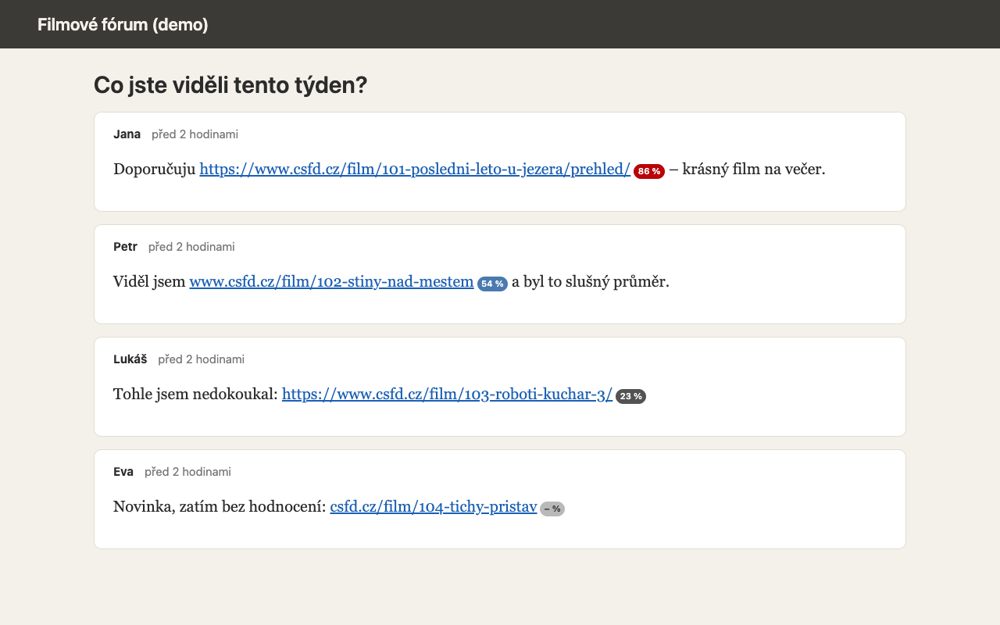

# ČSFD hodnocení všude

**Rozšíření pro Chrome, Edge a Firefox.** Na jakémkoli webu najde odkazy na ČSFD, i když jsou jen jako text, udělá z nich klikatelné odkazy a ukáže u nich hodnocení filmu v procentech.

## Instalace

- Chrome: *již brzy v Chrome Web Store*
- Edge: *již brzy v Edge Add-ons*
- Firefox: *již brzy na addons.mozilla.org*

## Jak to funguje

- Textové odkazy na ČSFD se změní na klikatelné, a to i u seriálů a epizod.
- Hodnocení se ukáže hned u prvních 10 filmů na stránce. U ostatních se načte, když na odkaz najedete myší.
- Barvy jako na ČSFD: červená od 70 %, modrá 30–69 %, šedá pod 30 %.
- Stačí si vybrat: malý odznak u odkazu, nebo jen plovoucí karta při najetí myší (v Nastavení).
- Na konkrétních webech jde rozšíření vypnout jedním kliknutím.

## Soukromí

Žádná analytika ani sběr dat. Hodnocení se stahuje přímo z csfd.cz a ukládá jen ve vašem prohlížeči. Podrobně v [zásadách ochrany soukromí](PRIVACY.html).

## Podpora

Chyby a nápady pište do [GitHub Issues](https://github.com/tohu12/csfd-ratings-everywhere/issues). Zdrojový kód je [otevřený (MIT)](https://github.com/tohu12/csfd-ratings-everywhere).

---

*Neoficiální rozšíření, není spojeno s ČSFD. „ČSFD“ je ochranná známka svého vlastníka a je zde použita jen k popisu kompatibility.*

---

## In English

**ČSFD Ratings Everywhere** turns links to ČSFD (the Czech-Slovak film database) on any website into clickable links with the film's rating. Cached ratings and the first 10 films on a page show right away; others load when you hover. No analytics, no data collection. [Privacy policy](PRIVACY.html) · [Support](https://github.com/tohu12/csfd-ratings-everywhere/issues).
